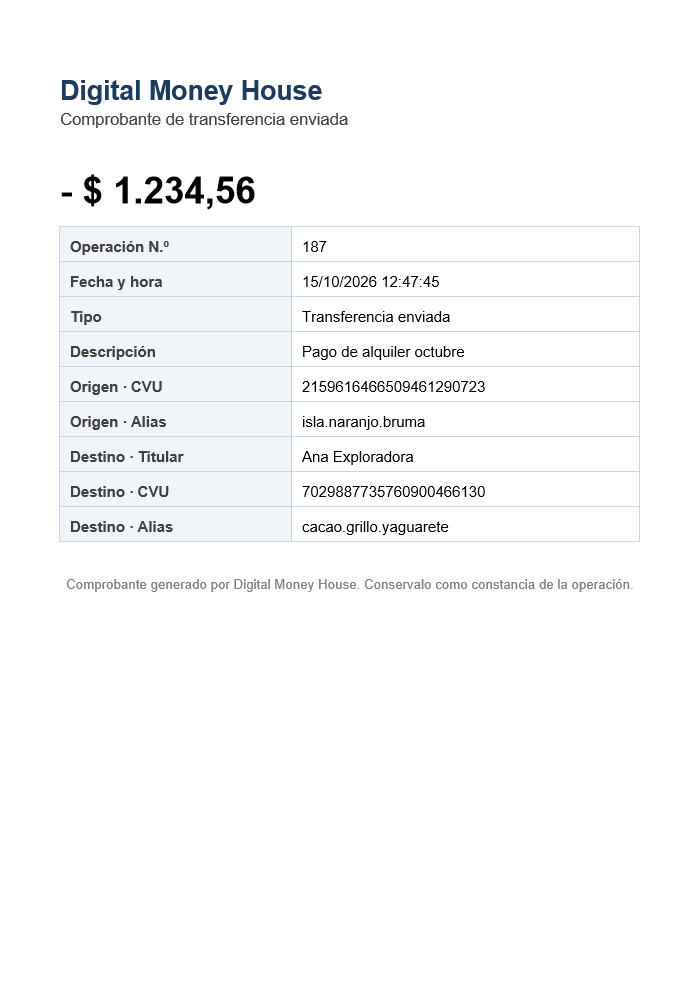

# Ejemplos de la API (request y response)

Respuestas **reales**, capturadas recorriendo el flujo completo contra el sistema levantado
(`POST` de registro → verificación → login → cuenta → tarjeta → ingreso → transferencia → actividad →
comprobante → logout). Todos los requests van al gateway: `http://localhost:8090`.
Solo se acortó el token y se cambiaron los emails por unos fijos.

Lo mismo se puede probar con la colección de Postman ([docs/postman](postman)) o desde Swagger
(`http://localhost:8090/swagger-ui.html`).

## Sprint 1 — Registro, login y logout

### Registrar un usuario

Crea el usuario y su cuenta digital (CVU de 22 dígitos y alias de tres palabras). Envía un código de 6 dígitos al email.

```http
POST /users/register
Content-Type: application/json

{
  "firstName": "Juan",
  "lastName": "Perez",
  "dni": "30123456",
  "email": "juan.perez@mail.com",
  "phone": "+5491122334455",
  "password": "Clave1234"
}
```

Respuesta **201**

```json
{
  "id": 1,
  "firstName": "Juan",
  "lastName": "Perez",
  "dni": "30123456",
  "email": "juan.perez@mail.com",
  "phone": "+5491122334455",
  "accountId": 1,
  "cvu": "2923847932147848876593",
  "alias": "fogata.ciervo.jilguero"
}
```

### Login antes de verificar el email

```http
POST /auth/login
Content-Type: application/json

{
  "email": "juan.perez@mail.com",
  "password": "Clave1234"
}
```

Respuesta **403**

```json
{
  "timestamp": "2026-10-15T16:51:53.949332500Z",
  "status": 403,
  "error": "Forbidden",
  "message": "Debe verificar su email antes de ingresar. Revise el código que le enviamos por correo.",
  "path": "/auth/login"
}
```

### Verificar el email con el código

```http
POST /auth/verify-email
Content-Type: application/json

{
  "email": "juan.perez@mail.com",
  "code": "266602"
}
```

Respuesta **200**

```json
{
  "message": "Email verificado. Ya puede iniciar sesión."
}
```

### Login

El token se manda en el header `Authorization: Bearer <token>` en el resto de los requests. Dura 1 hora.

```http
POST /auth/login
Content-Type: application/json

{
  "email": "juan.perez@mail.com",
  "password": "Clave1234"
}
```

Respuesta **200**

```json
{
  "token": "eyJhbGciOiJIUzI1NiJ9.eyJqdGkiOiJhMWE2...",
  "tokenType": "Bearer",
  "expiresIn": 3600
}
```

### Logout

```http
POST /user/logout
Authorization: Bearer <token>
```

Respuesta **200**

```json
{
  "message": "Sesión cerrada"
}
```

### Usar el token después del logout

```http
GET /accounts/1
Authorization: Bearer <token>
```

Respuesta **401**

```json
{
  "timestamp": "2026-10-15T16:51:55.563851Z",
  "status": 401,
  "error": "Unauthorized",
  "message": "Token inválido, vencido o sesión cerrada",
  "path": "/accounts/1"
}
```

## Sprint 2 — Cuenta, perfil y tarjetas

### Dinero disponible

```http
GET /accounts/1
Authorization: Bearer <token>
```

Respuesta **200**

```json
{
  "id": 1,
  "userId": 1,
  "cvu": "2923847932147848876593",
  "alias": "fogata.ciervo.jilguero",
  "balance": 0.00
}
```

### Cambiar el alias

```http
PATCH /accounts/1
Authorization: Bearer <token>
Content-Type: application/json

{
  "alias": "juan.perez.dmh"
}
```

Respuesta **200**

```json
{
  "id": 1,
  "userId": 1,
  "cvu": "2923847932147848876593",
  "alias": "juan.perez.dmh",
  "balance": 0.00
}
```

### Perfil del usuario

```http
GET /users/1
Authorization: Bearer <token>
```

Respuesta **200**

```json
{
  "id": 1,
  "firstName": "Juan",
  "lastName": "Perez",
  "dni": "30123456",
  "email": "juan.perez@mail.com",
  "phone": "+5491122334455"
}
```

### Editar el perfil

Todos los campos son opcionales: se cambian solo los que se envían.

```http
PATCH /users/1
Authorization: Bearer <token>
Content-Type: application/json

{
  "phone": "+5491199998888"
}
```

Respuesta **200**

```json
{
  "id": 1,
  "firstName": "Juan",
  "lastName": "Perez",
  "dni": "30123456",
  "email": "juan.perez@mail.com",
  "phone": "+5491199998888"
}
```

### Asociar una tarjeta

El número completo y el CVV no se guardan: solo los últimos 4 dígitos y una huella para detectar duplicados.

```http
POST /accounts/1/cards
Authorization: Bearer <token>
Content-Type: application/json

{
  "number": "4509953566233704",
  "holderName": "Juan Perez",
  "expiration": "12/30",
  "cvv": "123",
  "type": "DEBIT"
}
```

Respuesta **201**

```json
{
  "id": 1,
  "accountId": 1,
  "number": "**** **** **** 3704",
  "lastFour": "3704",
  "brand": "VISA",
  "type": "DEBIT",
  "holderName": "JUAN PEREZ",
  "expiration": "12/30",
  "expired": false,
  "createdAt": "2026-10-15T16:51:54.770890800Z"
}
```

### Asociar una tarjeta que ya está asociada

```http
POST /accounts/1/cards
Authorization: Bearer <token>
Content-Type: application/json

{
  "number": "4509953566233704",
  "holderName": "Juan Perez",
  "expiration": "12/30",
  "cvv": "123",
  "type": "DEBIT"
}
```

Respuesta **409**

```json
{
  "timestamp": "2026-10-15T16:51:54.813783400Z",
  "status": 409,
  "error": "Conflict",
  "message": "La tarjeta ya está asociada a esta cuenta",
  "path": "/accounts/1/cards"
}
```

### Listar las tarjetas

Si la cuenta no tiene tarjetas devuelve `[]` con 200.

```http
GET /accounts/1/cards
Authorization: Bearer <token>
```

Respuesta **200**

```json
[
  {
    "id": 1,
    "accountId": 1,
    "number": "**** **** **** 3704",
    "lastFour": "3704",
    "brand": "VISA",
    "type": "DEBIT",
    "holderName": "JUAN PEREZ",
    "expiration": "12/30",
    "expired": false,
    "createdAt": "2026-10-15T16:51:54.770891Z"
  }
]
```

### Intentar ver la cuenta de otro usuario

```http
GET /accounts/2
Authorization: Bearer <token>
```

Respuesta **403**

```json
{
  "timestamp": "2026-10-15T16:51:55.474773400Z",
  "status": 403,
  "error": "Forbidden",
  "message": "No tiene permisos para acceder a este recurso",
  "path": "/accounts/2"
}
```

## Sprint 3 — Ingreso de dinero y actividad

### Ingresar dinero desde una tarjeta

```http
POST /accounts/1/transferences
Authorization: Bearer <token>
Content-Type: application/json

{
  "cardId": 1,
  "amount": 50000
}
```

Respuesta **201**

```json
{
  "id": 1,
  "accountId": 1,
  "type": "DEPOSIT",
  "direction": "INCOME",
  "amount": 50000.00,
  "description": "Ingreso desde tarjeta terminada en 3704",
  "date": "2026-10-15T16:51:54.898347400Z",
  "cardLastFour": "3704"
}
```

### Últimos 5 movimientos

```http
GET /accounts/1/transactions
Authorization: Bearer <token>
```

Respuesta **200**

```json
[
  {
    "id": 2,
    "accountId": 1,
    "type": "TRANSFER_OUT",
    "direction": "EXPENSE",
    "amount": 1500.50,
    "description": "Cena del viernes",
    "date": "2026-10-15T16:51:54.941354Z",
    "counterpart": {
      "accountId": 2,
      "cvu": "5382383311879707114523",
      "alias": "marea.rio.diente",
      "name": "Ana Gomez"
    }
  },
  {
    "id": 1,
    "accountId": 1,
    "type": "DEPOSIT",
    "direction": "INCOME",
    "amount": 50000.00,
    "description": "Ingreso desde tarjeta terminada en 3704",
    "date": "2026-10-15T16:51:54.898347Z",
    "cardLastFour": "3704"
  }
]
```

### Actividad con filtros

Filtros opcionales: `direction` (`INCOME`/`EXPENSE`), `from` y `to` (`AAAA-MM-DD`), `minAmount`, `maxAmount`.

```http
GET /accounts/1/activity?direction=EXPENSE&minAmount=1000
Authorization: Bearer <token>
```

Respuesta **200**

```json
[
  {
    "id": 2,
    "accountId": 1,
    "type": "TRANSFER_OUT",
    "direction": "EXPENSE",
    "amount": 1500.50,
    "description": "Cena del viernes",
    "date": "2026-10-15T16:51:54.941354Z",
    "counterpart": {
      "accountId": 2,
      "cvu": "5382383311879707114523",
      "alias": "marea.rio.diente",
      "name": "Ana Gomez"
    }
  }
]
```

### Detalle de un movimiento

```http
GET /accounts/1/activity/2
Authorization: Bearer <token>
```

Respuesta **200**

```json
{
  "id": 2,
  "accountId": 1,
  "type": "TRANSFER_OUT",
  "direction": "EXPENSE",
  "amount": 1500.50,
  "description": "Cena del viernes",
  "date": "2026-10-15T16:51:54.941354Z",
  "counterpart": {
    "accountId": 2,
    "cvu": "5382383311879707114523",
    "alias": "marea.rio.diente",
    "name": "Ana Gomez"
  }
}
```

## Sprint 4 — Transferencias y comprobante

### Transferir a otra cuenta

`destination` acepta CVU, CBU o alias. El header `Idempotency-Key` es opcional: si se repite el mismo request con la misma clave, devuelve la operación original (header `Idempotent-Replayed: true`) en lugar de transferir dos veces.

```http
POST /accounts/1/transferences
Authorization: Bearer <token>
Content-Type: application/json
Idempotency-Key: pago-cena-001

{
  "destination": "marea.rio.diente",
  "amount": 1500.50,
  "description": "Cena del viernes"
}
```

Respuesta **200**

```json
{
  "id": 2,
  "accountId": 1,
  "type": "TRANSFER_OUT",
  "direction": "EXPENSE",
  "amount": 1500.50,
  "description": "Cena del viernes",
  "date": "2026-10-15T16:51:54.941354300Z",
  "counterpart": {
    "accountId": 2,
    "cvu": "5382383311879707114523",
    "alias": "marea.rio.diente",
    "name": "Ana Gomez"
  }
}
```

### Transferir sin fondos suficientes

```http
POST /accounts/1/transferences
Authorization: Bearer <token>
Content-Type: application/json

{
  "destination": "5382383311879707114523",
  "amount": 999999
}
```

Respuesta **410**

```json
{
  "timestamp": "2026-10-15T16:51:55.096209500Z",
  "status": 410,
  "error": "Gone",
  "message": "Fondos insuficientes: el saldo disponible es $48499.50",
  "path": "/accounts/1/transferences"
}
```

### Transferir a una cuenta que no existe

```http
POST /accounts/1/transferences
Authorization: Bearer <token>
Content-Type: application/json

{
  "destination": "no.existe.nunca",
  "amount": 10
}
```

Respuesta **400**

```json
{
  "timestamp": "2026-10-15T16:51:55.119732600Z",
  "status": 400,
  "error": "Bad Request",
  "message": "La cuenta destino no existe: no.existe.nunca",
  "path": "/accounts/1/transferences"
}
```

### Últimos destinatarios

```http
GET /accounts/1/transferences
Authorization: Bearer <token>
```

Respuesta **200**

```json
[
  {
    "accountId": 2,
    "cvu": "5382383311879707114523",
    "alias": "marea.rio.diente",
    "name": "Ana Gomez",
    "lastTransferDate": "2026-10-15T16:51:54.941354Z",
    "lastAmount": 1500.50
  }
]
```

### Comprobante en PDF

```http
GET /accounts/1/activity/2/receipt
Authorization: Bearer <token>
```

Respuesta **200**

```json
(archivo PDF: Content-Type: application/pdf, Content-Disposition: attachment; filename="comprobante-2.pdf")
```


