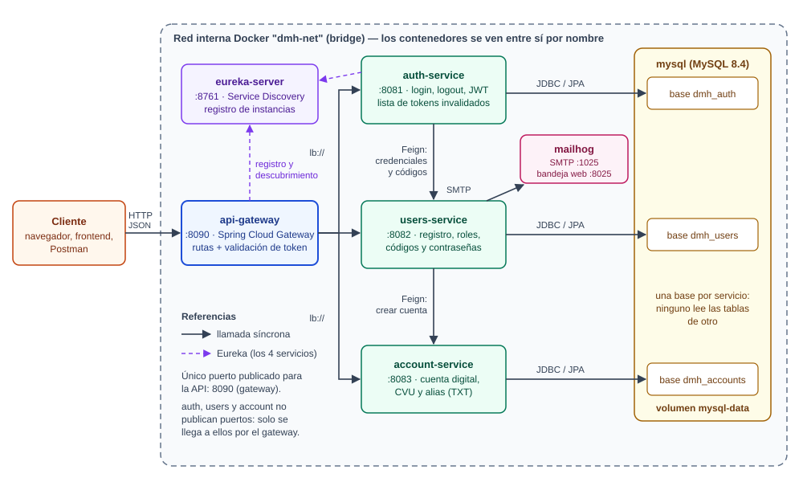
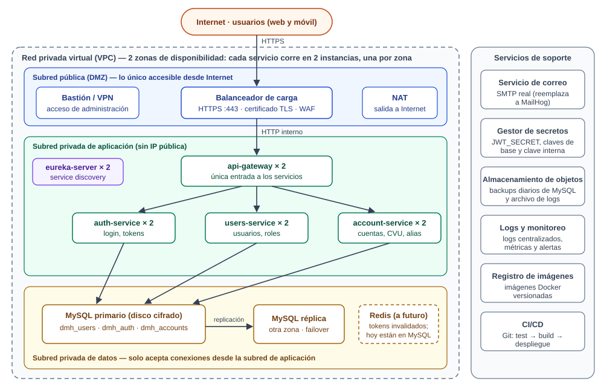

# Infraestructura — Digital Money House

## 1. Herramientas para el funcionamiento local

| Herramienta | Versión usada | Para qué |
|---|---|---|
| **Git** | 2.40 | Control de versiones. Ramas `main` (entregas), `dev` (desarrollo) y `test` (lo que se está probando). |
| **Docker + Docker Compose** | Docker 29 / Compose v2 | Empaquetar cada microservicio en una imagen y levantar todo el entorno con un comando. |
| **JDK** | Temurin 21 | Compilar y ejecutar (la guía pide 17 o superior). |
| **Maven Wrapper** | Maven 3.9.16 | Compilar sin instalar Maven: `mvnw` lo descarga la primera vez. |
| **Eclipse** | 2026-09 | IDE. El proyecto se importa como *Existing Maven Projects*. |

## 2. Funcionamiento en microservicios

| Servicio | Puerto | Responsabilidad | Base |
|---|---|---|---|
| `eureka-server` | 8761 | *Service discovery*: cada servicio se registra al arrancar y los demás lo encuentran por nombre. | — |
| `api-gateway` | 8090 | Único punto de entrada. Enruta por nombre de servicio (`lb://`) y valida el token de toda ruta no pública. | — |
| `auth-service` | 8081 | Login, emisión y validación de JWT, logout (lista de tokens invalidados). Expone también los endpoints públicos de verificación de email y recupero de contraseña. | `dmh_auth` |
| `users-service` | 8082 | Usuarios y roles: registro, contraseñas (BCrypt), códigos de verificación, tokens de recupero y envío de mails. | `dmh_users` |
| `account-service` | 8083 | Cuenta digital: genera CVU (22 dígitos) y alias (3 palabras de un TXT), saldo. | `dmh_accounts` |

Cómo se comunican:

- **Cliente → gateway → servicio**: HTTP/JSON. El gateway resuelve la dirección en Eureka.
- **Servicio → servicio**: OpenFeign sobre HTTP, también resolviendo por Eureka. `users-service`
  llama a `account-service` para crear la cuenta; `auth-service` llama a `users-service` para
  validar credenciales. Estas llamadas van a endpoints `/internal/**`, que no tienen ruta en el
  gateway y exigen una clave compartida (`X-Internal-Api-Key`).
- **Servicio → base**: Spring Data JPA sobre JDBC. Un solo servidor MySQL con **una base por
  servicio**: ningún servicio lee las tablas de otro. Es el punto medio entre la base compartida
  (más simple, pero acopla los servicios) y un servidor por servicio (más aislado, pero pesado para
  un entorno local).

## 3. Red y componentes del entorno local

| Componente | Detalle |
|---|---|
| **Red** | `dmh-net`, una red *bridge* de Docker. Los contenedores se alcanzan entre sí por nombre (`mysql`, `eureka-server`...). |
| **Puertos publicados** | `8090` (gateway, la API). Solo en `127.0.0.1`, para desarrollo: `8761` (panel de Eureka), `8025` (bandeja de MailHog), `3307` (MySQL, para conectarse con un cliente SQL). `auth`, `users` y `account` **no publican puertos**. |
| **Servidores** | 7 contenedores: los 5 microservicios (imagen `eclipse-temurin:21-jre`, proceso sin privilegios de root), `mysql:8.4` y `mailhog`. |
| **Almacenamiento** | Volumen `mysql-data` para los datos de MySQL: sobreviven a `docker compose down` y se borran con `down -v`. |
| **Base de datos** | MySQL 8.4 con las bases `dmh_users`, `dmh_accounts` y `dmh_auth` (las crea `docker/mysql/init.sql`); las tablas las crea JPA (`ddl-auto: update`). |
| **Configuración** | Variables de entorno (`JWT_SECRET`, `INTERNAL_API_KEY`, claves de base) con valores por defecto solo para desarrollo; se cambian con un archivo `.env` (ver `.env.example`). |
| **Orden de arranque** | MySQL con *healthcheck*; los servicios con base esperan a que esté sano. |

Las imágenes se construyen con un único `Dockerfile` de dos etapas: la primera compila con Maven
y la segunda copia solo el `.jar` sobre una imagen con el JRE.

## 4. Diseño de la infraestructura necesaria (propuesta para un entorno productivo)

| Capa | Componentes | Por qué |
|---|---|---|
| **Borde** | Balanceador de carga con HTTPS y WAF, en la subred pública. | Es lo único expuesto a Internet. Termina TLS y reparte entre las instancias del gateway. |
| **Aplicación** | Gateway, los tres servicios y Eureka, cada uno en 2 instancias repartidas en 2 zonas, en una subred privada. | Sin IP pública: solo se llega por el balanceador. Dos instancias dan tolerancia a la caída de una zona y permiten desplegar sin corte. Los servicios no guardan estado de sesión (el JWT viaja en cada petición), así que escalan agregando instancias. |
| **Datos** | MySQL primario y réplica en otra zona, con disco cifrado, en una subred que solo acepta conexiones desde la de aplicación. | Los datos de una billetera no pueden perderse ni quedar expuestos. |
| **Almacenamiento** | Almacenamiento de objetos para backups diarios de la base y archivo de logs. | Poder restaurar ante un borrado accidental y conservar el historial. |
| **Soporte** | Servicio de correo real, gestor de secretos, logs y métricas centralizados, registro de imágenes y CI/CD. | Los secretos dejan de estar en archivos; cada cambio pasa por test → build → despliegue. |
| **Administración** | Bastión o VPN. | Nadie se conecta directo a servidores ni a la base desde Internet. |

Diferencias con el entorno local a tener en cuenta al pasar a producción:

- `ddl-auto: update` se reemplaza por migraciones versionadas (Flyway o Liquibase).
- La lista de tokens invalidados puede pasar de MySQL a Redis, con vencimiento automático por clave.
- Swagger UI y los endpoints de Actuator se restringen o se desactivan.
- En un orquestador como Kubernetes, el descubrimiento de servicios lo da la plataforma y Eureka
  deja de ser necesario.

## 5. Estado en la máquina de desarrollo

`docker compose config` valida el archivo, pero **el entorno con Docker no pudo levantarse** en
esta máquina: Docker Desktop no arranca porque Windows no tiene habilitada la característica
"Plataforma de máquina virtual" (hace falta ejecutar `wsl.exe --install --no-distribution` como
administrador y reiniciar). Mientras tanto el sistema se levanta y se prueba con
`scripts/start-local.ps1` (perfil `h2`). Ver el README, sección *Problemas conocidos*.
